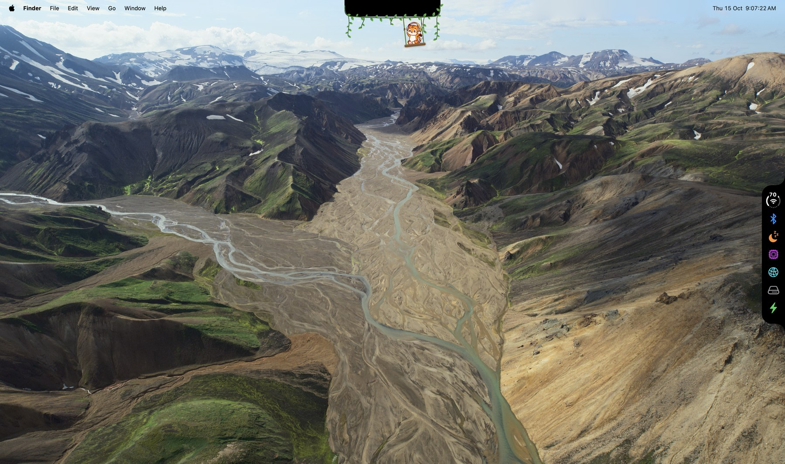
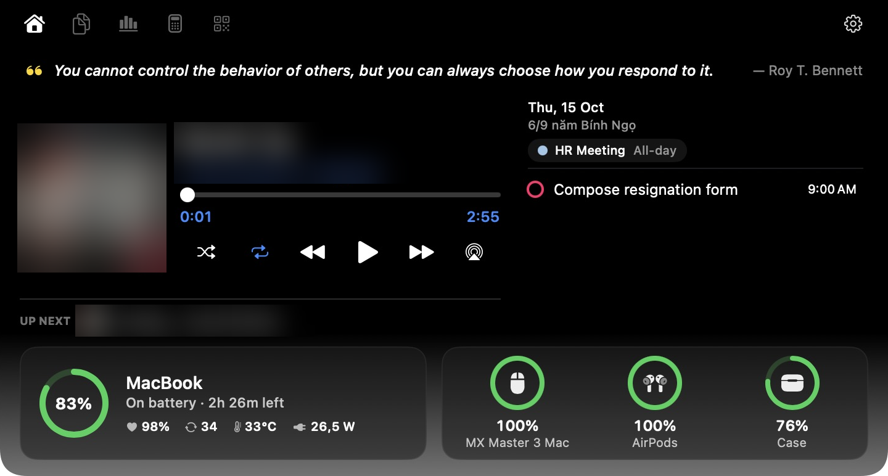

# FreeTheNotch

A Dynamic Island for the MacBook notch, a system dashboard in the menu bar, and widgets on the lock screen.

- **Version:** 0.1.1
- **Requires:** macOS 14 or later, Apple Silicon. Developed and tested on macOS 27.
- **Docs:** [Screenshots](docs/GALLERY.md) · [Settings](docs/SETTINGS.md) · [Feature guide](docs/FEATURES.md) · [Technical Design](docs/TECHNICAL_DESIGN.md)

## Features

- **Notch:** media controls, calendar and reminders, clipboard history, timers, calculator and offline QR codes.
- **Live activities:** Now Playing, timers, Caps Lock, volume, keyboard backlight, battery, Bluetooth and AI session status.
- **AI Usage:** Codex and Claude quota, reset times, local token totals, estimated API cost and quota warnings.
- **System dashboard:** CPU/GPU, memory, network, disks, battery and Keep Awake.
- **Side Notch:** optional screen-edge controls for Wi-Fi, sound, Bluetooth and the system dashboard. When enabled, either click on the menu bar icon opens quick actions; when disabled, left click opens the dashboard and right click opens quick actions.
- **Lock screen:** media, timers, battery and weather widgets, calendar events, reminders and optional artwork wallpaper.
- **Utilities and appearance:** smooth mouse scrolling, Cleaning Mode, skins and custom Lottie pets.

### On your desktop

The closed notch with the Jungle skin and Side Notch controls:



### Inside the notch

Music, calendar, reminders and device batteries together. Artwork and track details are blurred.



Explore the [feature screenshots](docs/GALLERY.md) for AI Usage, tools, system monitoring, connectivity and lock-screen widgets, or the [Settings gallery](docs/SETTINGS.md) for configuration. Controls, permissions and limits are in the [feature guide](docs/FEATURES.md).

Calendar, clipboard, settings and local AI logs stay on your Mac. FreeTheNotch has no account or telemetry service of its own. Some features use external services for weather, quotes, speed tests, AI quota and model prices; see [Privacy](docs/FEATURES.md#privacy).

## Install

1. **Download** `FreeTheNotch-<version>.zip` from the [latest release](https://github.com/nqnhut92/FreeTheNotch/releases/latest), unzip it, and drag `FreeTheNotch.app` into **Applications**.
2. **Open it.** FreeTheNotch is not notarized by Apple, so macOS blocks the first launch. Click **Done**, then open **System Settings → Privacy & Security**, scroll down to the message about FreeTheNotch, click **Open Anyway** and confirm. You only do this once.
3. **Grant permissions** when macOS asks. Each one is needed only by the features in the [permissions guide](docs/FEATURES.md#permissions); everything else works without it.
4. **Start at login (optional):** turn on **Settings → General → Launch at login**.

The app lives in the menu bar and the notch; it shows a Dock icon only while Settings is open. To update, quit FreeTheNotch (right-click the menu bar cup → Quit) and replace the app in Applications with the new one; permissions carry over. The About page shows the version and build you are running.

### Build from source

Open `FreeTheNotch.xcodeproj` in Xcode, select the FreeTheNotch target → **Signing & Capabilities** and choose your own Team (a free Apple ID works). Then choose **Product → Archive → Distribute App → Custom → Copy App** and move the copy to Applications. A copy you build yourself is signed differently from a release, so macOS asks for permissions again when you switch between them.

## Development

Open `FreeTheNotch.xcodeproj`. Application code lives in `Sources/`; tests live in `Tests/`. Follow [AGENTS.md](AGENTS.md) and [Technical Design](docs/TECHNICAL_DESIGN.md). Validate changes from the shell:

```sh
xcodebuild -project FreeTheNotch.xcodeproj -scheme FreeTheNotch -configuration Debug test CODE_SIGNING_ALLOWED=NO
xcodebuild -project FreeTheNotch.xcodeproj -scheme FreeTheNotch -configuration Release build CODE_SIGNING_ALLOWED=NO
swift format lint -r Sources Tests
```

## Credits

FreeTheNotch builds on these open-source projects, under their licenses:

- [Atoll](https://github.com/Ebullioscopic/Atoll) (GPL-3.0-or-later): notch, HUDs, lock screen, media, calendar and Bluetooth.
- [Vorssaint](https://github.com/vorssaint/vorssaint-utils) (GPL-3.0-or-later): menu bar panel, SMC reader, calculator parser, and smooth mouse scrolling.
- [DuoBar](https://github.com/Mikeli7666/DuoBar) (MIT): DuoGlyph layout, Wi-Fi monitoring and glyph hosting.
- [Zstandard](https://github.com/facebook/zstd) (BSD-3-Clause): decoder for Claude Desktop usage cache.
- [CodeNotch](https://github.com/vinzdg/codenotch) (MIT): Side Notch shape, sizes and panel placement; AI usage pricing and streamed token accounting.
- [LaunchAtLogin-Modern](https://github.com/sindresorhus/LaunchAtLogin-Modern) (MIT): Launch at login switch.
- Lunar calendar astronomy from Jean Meeus, *Astronomical Algorithms* (2nd ed., 1998); the implementation is FreeTheNotch's own.
- Inspirational quotes provided by [ZenQuotes API](https://zenquotes.io/).
- [Lottie](https://github.com/airbnb/lottie-ios) (Apache-2.0): animation playback.
- Pet animations from [LottieFiles](https://lottiefiles.com) (Lottie Simple License): Orange Cat Peeping by Kanika, Moody Dog and Reindeer by Bashir, Tiger Happy by Ludovic.

---

## License

FreeTheNotch is free software under the [GNU General Public License v3.0 or later](LICENSE). License notices for the projects it builds on are in [THIRD_PARTY_NOTICES.md](THIRD_PARTY_NOTICES.md).

2026 Nicholas Nguyen
