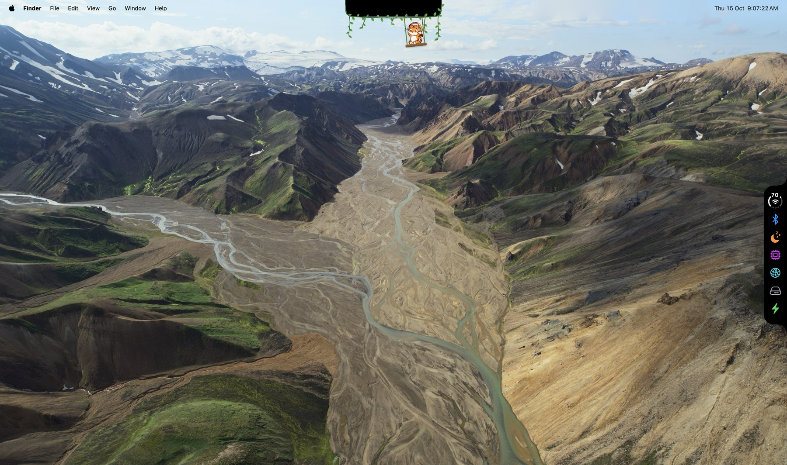
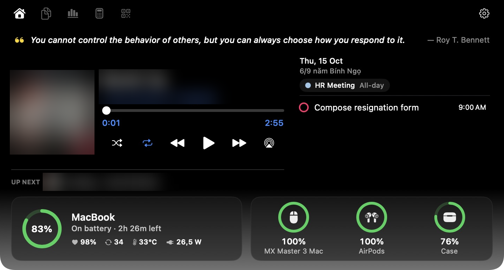
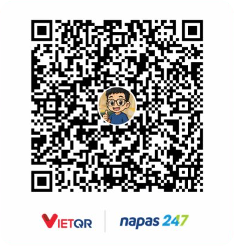

# FreeTheNotch

A Dynamic Island for the MacBook notch, a system dashboard in the menu bar, and widgets on the lock screen.

- **Version:** 1.2.0
- **Requires:** macOS 14 or later, Apple Silicon. Developed and tested on macOS 27.
- **Interactive demo:** [freethenotch.nqnhut92.top](https://freethenotch.nqnhut92.top)
- **Docs:** [Screenshots](docs/GALLERY.md) · [Settings](docs/SETTINGS.md) · [Feature guide](docs/FEATURES.md) · [Technical Design](docs/TECHNICAL_DESIGN.md)
- **Support:** [Ko-fi](https://ko-fi.com/nqnhut92) · [Vietnam QR](https://freethenotch.nqnhut92.top/#support-vn)

## Features

- **Notch:** media controls (a spinning record for Apple Music), calendar and reminders, clipboard history, timers, calculator and offline QR codes.
- **Live activities:** Now Playing, timers, Caps Lock, volume, keyboard backlight, battery, Bluetooth, iPhone / iPad sync and AI session status.
- **AI Usage:** Codex and Claude quota, reset times, local token totals, estimated API cost and 80% quota warnings.
- **System dashboard:** CPU/GPU, memory, network, disks, battery and Keep Awake.
- **Side Notch:** optional screen-edge controls for Wi-Fi, sound, Bluetooth and the system dashboard.
- **Lock screen:** media, timers, battery and weather widgets, calendar events, reminders and optional artwork wallpaper.
- **Utilities and appearance:** smooth mouse scrolling, Cleaning Mode, skins and custom Lottie pets.

Try the [interactive web demo](https://freethenotch.nqnhut92.top), or see the [screenshots](docs/GALLERY.md), [Settings gallery](docs/SETTINGS.md) and [feature & privacy guide](docs/FEATURES.md).

## Install

1. Download `FreeTheNotch-<version>.zip` from the [latest release](https://github.com/nqnhut92/FreeTheNotch/releases/latest), unzip it, and move `FreeTheNotch.app` into **Applications**.
2. First launch is blocked because the app is not notarized: click **Done**, then open **System Settings → Privacy & Security → Open Anyway**.
3. Grant permissions only for the features you enable (see [Permissions](docs/FEATURES.md#permissions)); for Claude quota, run `claude auth login` once in Terminal.

To update, quit FreeTheNotch (right-click the menu bar icon → Quit) and replace the app in Applications. To build from source, open `FreeTheNotch.xcodeproj`, set your Team under **Signing & Capabilities**, and archive via **Product → Archive → Distribute App → Custom → Copy App**.

## Development

Open `FreeTheNotch.xcodeproj`. Application code lives in `Sources/`; tests live in `Tests/`. See [Technical Design](docs/TECHNICAL_DESIGN.md) for architecture and build details.

## Credits

FreeTheNotch builds on these open-source projects, under their licenses:

- [Atoll](https://github.com/Ebullioscopic/Atoll) (GPL-3.0-or-later): notch, HUDs, lock screen, media, calendar and Bluetooth.
- [Vorssaint](https://github.com/vorssaint/vorssaint-utils) (GPL-3.0-or-later): menu bar panel, SMC reader, calculator parser, and smooth mouse scrolling.
- [DuoBar](https://github.com/Mikeli7666/DuoBar) (MIT): DuoGlyph layout, Wi-Fi monitoring and glyph hosting.
- [CodeNotch](https://github.com/vinzdg/codenotch) (MIT): Side Notch shape, sizes and panel placement; AI usage pricing and streamed token accounting.
- [LaunchAtLogin-Modern](https://github.com/sindresorhus/LaunchAtLogin-Modern) (MIT): Launch at login switch.
- Lunar calendar astronomy from Jean Meeus, *Astronomical Algorithms* (2nd ed., 1998); the implementation is FreeTheNotch's own.
- Inspirational quotes provided by [ZenQuotes API](https://zenquotes.io/).
- [Lottie](https://github.com/airbnb/lottie-ios) (Apache-2.0): animation playback.
- Pet animations from [LottieFiles](https://lottiefiles.com) (Lottie Simple License): Orange Cat Peeping by Kanika, Moody Dog and Reindeer by Bashir, Tiger Happy by Ludovic.

---

## Support

- **International:** [Support on Ko-fi](https://ko-fi.com/nqnhut92)
- **Vietnam (MoMo / VietQR):**

Show MoMo / VietQR code (0% fee · scan with any Vietnamese banking app)

## License

FreeTheNotch is free software under the [GNU General Public License v3.0 or later](LICENSE). License notices for the projects it builds on are in [THIRD_PARTY_NOTICES.md](THIRD_PARTY_NOTICES.md).

2026 Nicholas Nguyen
