# Feature gallery

Version 0.1.0, captured 2026-10-15.
Personal details are hidden; music artwork and track details are blurred.

[README](../README.md) · [Settings gallery](SETTINGS.md) · [Feature guide](FEATURES.md)

[Desktop](#desktop) · [Notch](#notch) · [System monitoring](#system-monitoring) · [Connectivity](#connectivity) · [Lock screen](#lock-screen)

## Desktop

The Jungle skin above the camera and Side Notch along the screen edge. The Dock is cropped out.

## Notch

### Home

### AI Usage

Codex and Claude quota, reset times and local token totals. Estimated API costs are not subscription bills.

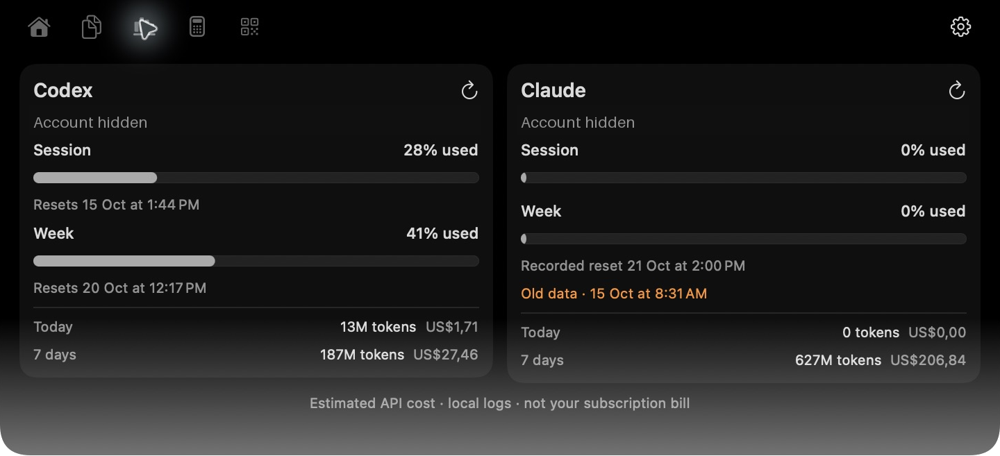

### Everyday tools

| Clipboard search | Calculator |
|---|---|
| 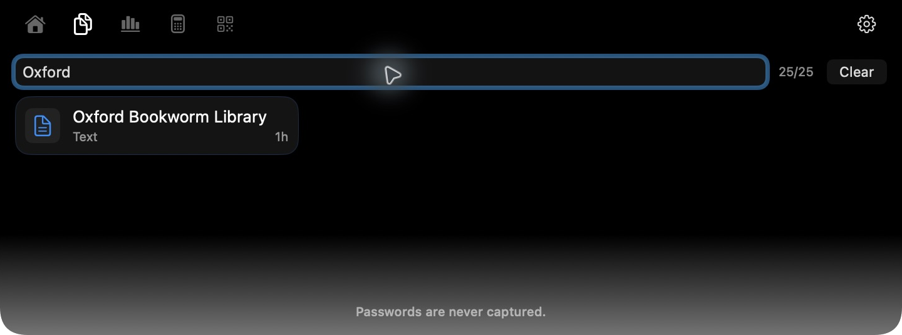 | 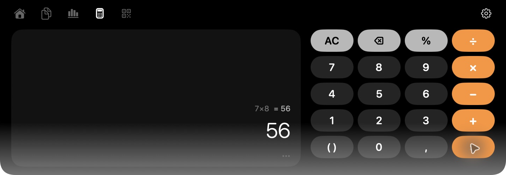 |

Offline QR generation using an example URL:

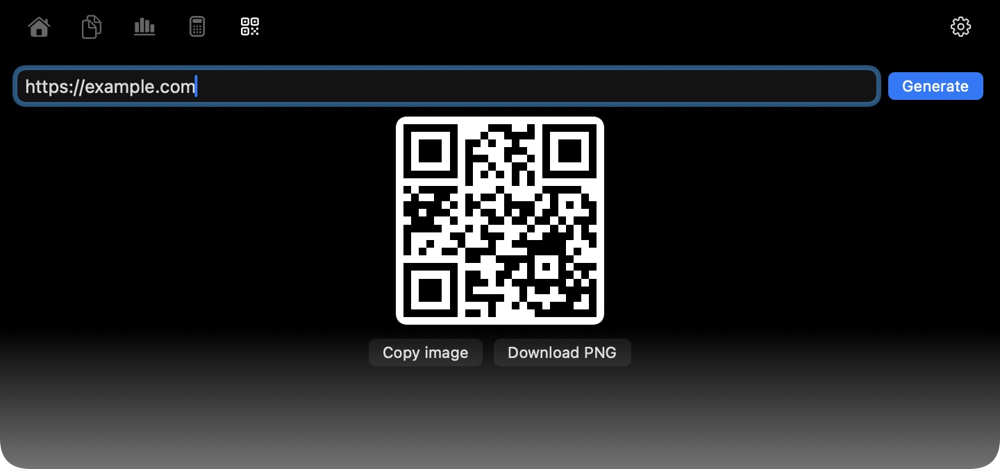

## System monitoring

### CPU, GPU and memory

| Overview | CPU core detail |
|---|---|
| 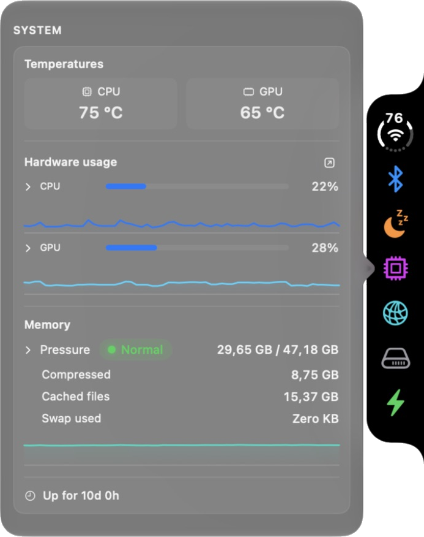 | 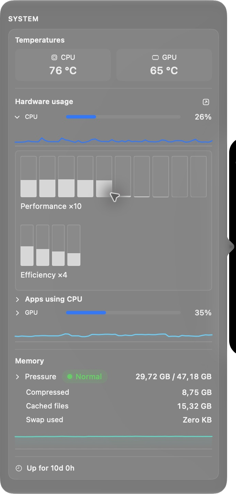 |

### Network, storage and power

Live network rates and per-app traffic. The local address is hidden.

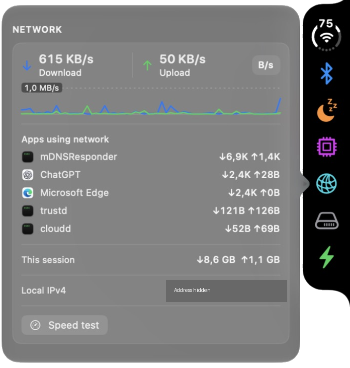

| Disks | Power |
|---|---|
| 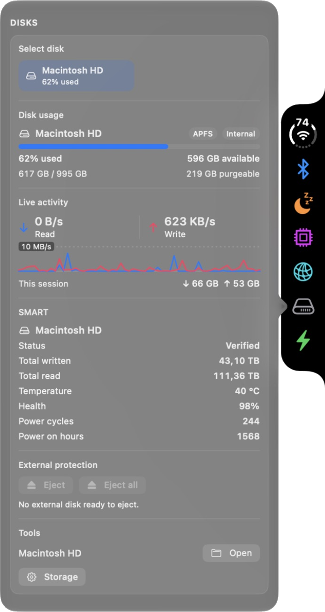 | 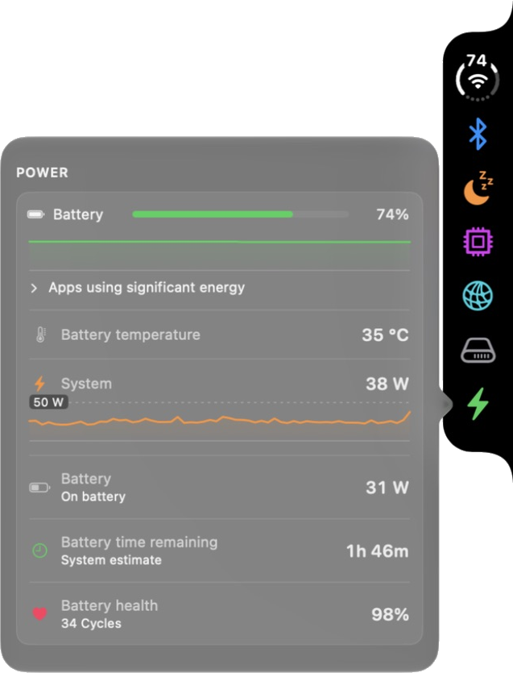 |

### Keep Awake

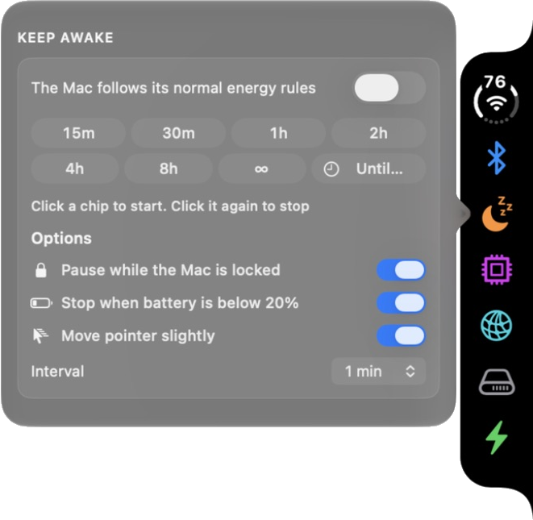

## Connectivity

Side Notch menus for connections, battery mode and audio output. Network and personal device names are hidden.

| Wi-Fi | Bluetooth |
|---|---|
| 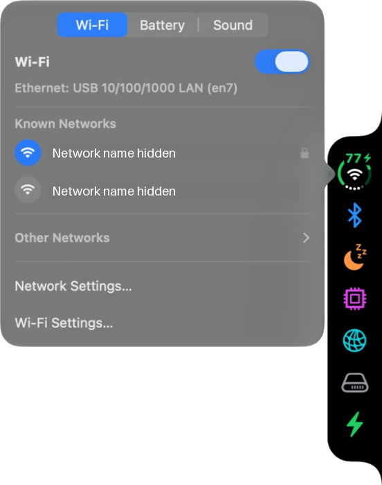 | 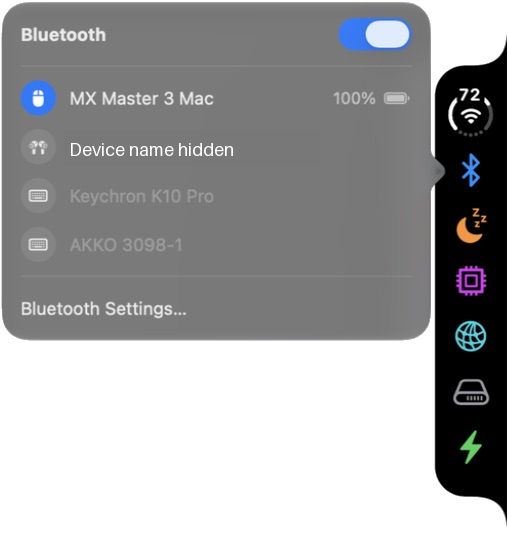 |

| Battery | Sound |
|---|---|
| 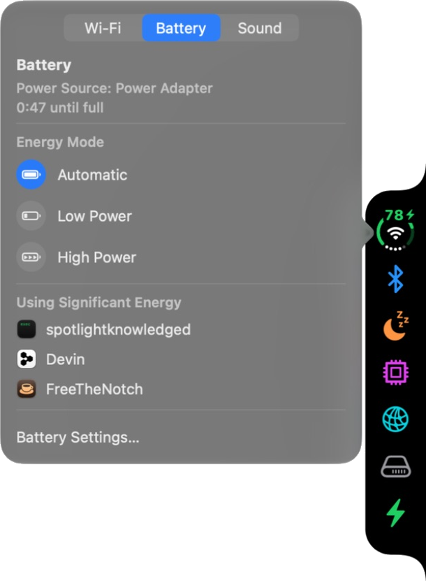 | 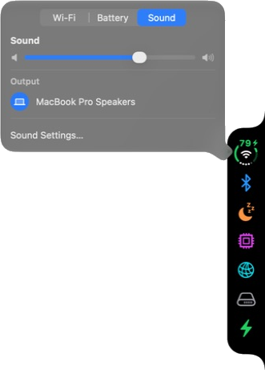 |

## Lock screen

Settings' zoomed widget preview with Samples enabled:

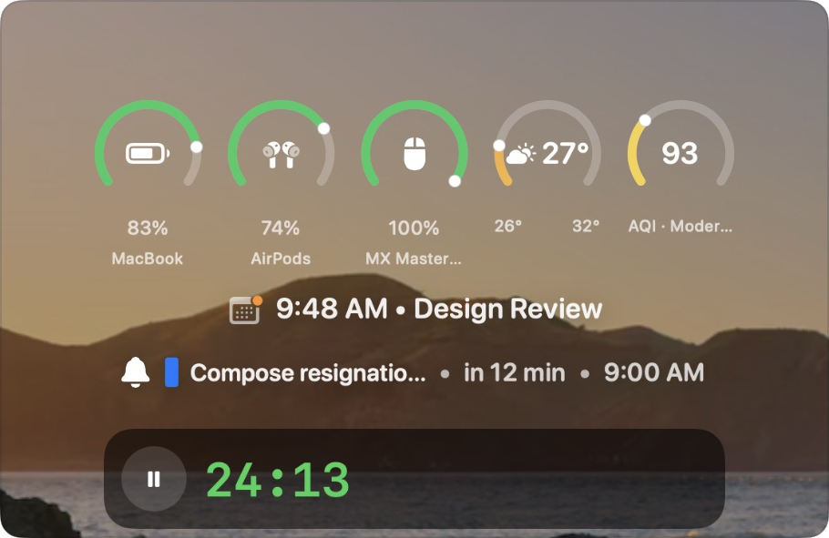

Configuration screenshots follow the sidebar order in the [Settings gallery](SETTINGS.md).
